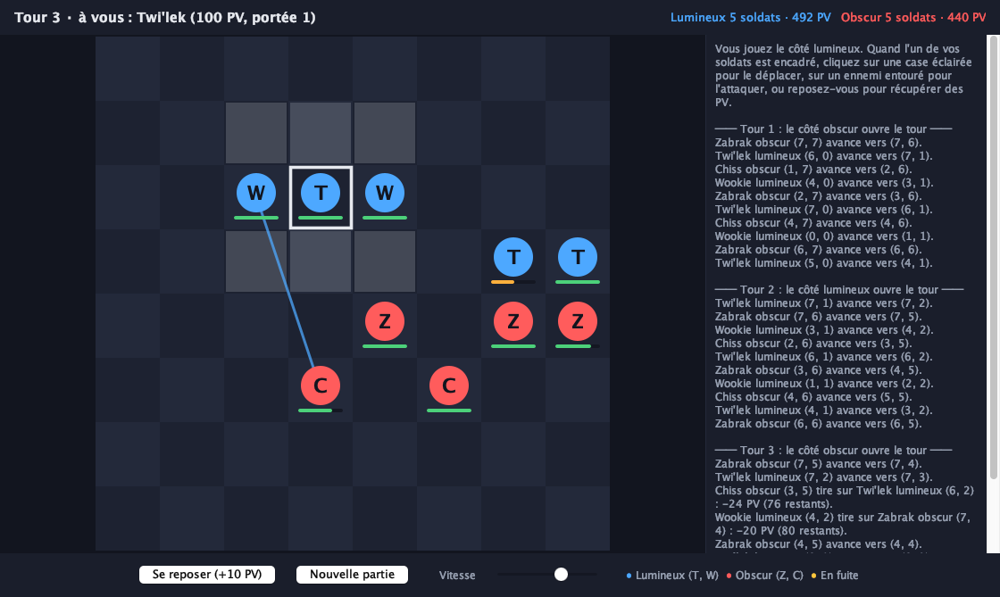
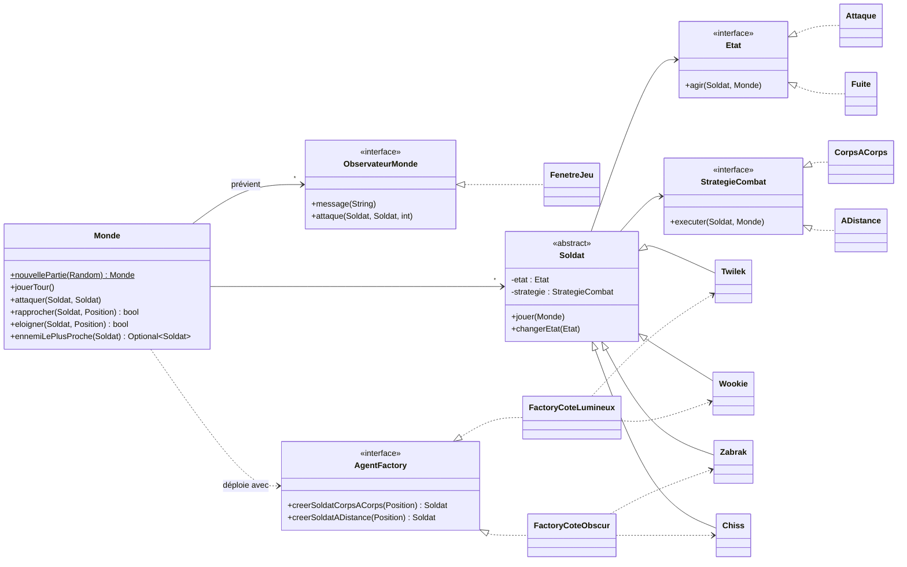

# Simulation Star Wars : côté lumineux contre côté obscur

Simulation de combat au tour par tour en Java, réalisée pour le cours d'architecture logicielle de l'ISIMA (2024-2025) par Jocelin Calas et Julen Somet-Garcia. Le but du projet est de mettre en œuvre des design patterns sur un cas concret.

Deux escouades de cinq soldats s'affrontent sur une carte de 8 × 8 cases. On peut contrôler l'un des deux camps contre l'ordinateur, ou regarder l'ordinateur jouer les deux camps. Les soldats de l'ordinateur avancent, attaquent, battent en retraite quand ils sont blessés puis reviennent au combat. L'interface graphique est en Swing, et une simulation existe aussi en mode texte dans le terminal.



## Lancer le projet

Il faut Java 17 ou plus récent. Il n'y a aucune dépendance en dehors des tests.

```bash
# Compiler et lancer l'interface graphique
javac -d out $(find src/main -name "*.java")
java -cp out simulation.Simulation

# Version texte dans le terminal
java -cp out simulation.Simulation --console
```

Avec Maven : `mvn test` lance les tests, `mvn package` produit un jar exécutable dans `target/`.

Au lancement, on choisit de jouer le côté lumineux, de jouer le côté obscur, ou de regarder l'ordinateur jouer contre lui-même.

**Contre l'ordinateur.** Quand c'est au tour de l'un de vos soldats, il est encadré en blanc :
- cliquez sur une case éclairée pour le déplacer ;
- cliquez sur un ennemi entouré pour l'attaquer ;
- ou cliquez sur **Se reposer** pour récupérer 10 PV.

Les soldats de l'ordinateur jouent ensuite un par un, à la vitesse réglée par le curseur.

**En simulation.** **Tour suivant** joue un tour, et **Lecture** fait jouer les tours automatiquement.

Dans les deux modes, le survol d'un soldat affiche ses PV, ses dégâts, sa portée et son mode.

## Règles

| Camp | Corps à corps (portée 1) | À distance (portée 3) |
|---|---|---|
| Lumineux | Twi'lek : 100 PV, 30 dégâts | Wookie : 120 PV, 20 dégâts |
| Obscur | Zabrak : 100 PV, 30 dégâts | Chiss : 90 PV, 24 dégâts |

- À chaque tour, les soldats des deux camps jouent **à tour de rôle**, un de chaque côté. Le camp qui ouvre le tour change à chaque tour.
- Les déplacements se font d'une case, diagonales comprises. Un soldat ne peut ni sortir de la carte ni aller sur une case occupée.
- Un soldat de l'ordinateur sous 30 % de ses PV **bat en retraite** : il s'éloigne et récupère 10 PV par tour, puis repart au combat dès qu'il atteint 70 %. S'il est acculé, il se défend. Les soldats du joueur, eux, ne font que ce que le joueur décide.
- La partie s'arrête dès qu'un camp est éliminé. Au bout de 100 tours, c'est le camp qui a le plus de PV au total qui l'emporte.

## Architecture



| Pattern | Où | Rôle |
|---|---|---|
| **Abstract Factory** | `factory/` | Chaque camp fournit sa famille de soldats. Le monde demande « un soldat de corps à corps » sans savoir s'il obtient un Twi'lek ou un Zabrak. |
| **State** | `etat/` | `Attaque` et `Fuite` sont les deux modes d'un soldat. Chaque état décide lui-même quand passer à l'autre, selon les PV. |
| **Strategy** | `strategie/` | La façon de combattre. `CorpsACorps` fonce sur l'ennemi le plus proche ; `ADistance` tire sur l'ennemi le plus affaibli à portée pour l'achever. |
| **Observer** | `monde/ObservateurMonde` | La fenêtre et la console s'abonnent aux événements du monde. Le modèle ne dépend pas de l'interface. |

Le `Monde` fait respecter les règles : les soldats *demandent* à se déplacer ou à attaquer, et le monde vérifie que c'est possible (case libre, cible à portée, etc.).

Le monde avance **soldat par soldat** : `getSoldatActif()` indique qui doit jouer. Si c'est un soldat de l'ordinateur, `avancer()` le fait jouer. Si c'est un soldat du joueur, le monde attend l'action choisie par l'interface (`deplacerSoldatDuJoueur`, `attaquerAvecSoldatDuJoueur` ou `reposerSoldatDuJoueur`) et la valide comme n'importe quelle autre.

```
src/main/java/simulation/
├── Simulation.java          point d'entrée (interface graphique ou --console)
├── monde/                   Monde, Position, Camp, ObservateurMonde
├── soldat/                  Soldat et les quatre espèces
├── factory/                 Abstract Factory
├── etat/                    State
├── strategie/               Strategy
└── ui/                      FenetreJeu, PlateauPanel (Swing)
src/test/java/simulation/    tests JUnit 5
```

## Tests

24 tests JUnit couvrent :
- les règles de déplacement et d'attaque ;
- chaque pattern ;
- le mode joueur : le monde attend le joueur et refuse les actions impossibles ;
- 200 parties complètes, en vérifiant qu'aucun soldat ne sort de la carte ou ne partage une case ;
- l'équité entre les camps.

```bash
javac -d out $(find src/main -name "*.java")
javac -d out-test -cp out:junit-platform-console-standalone.jar $(find src/test -name "*.java")
java -jar junit-platform-console-standalone.jar execute -cp out:out-test --select-package simulation
```

## Ce qui a changé depuis le rendu

La version rendue en janvier 2025 compilait, mais plusieurs bugs faussaient les combats :
- la portée des soldats n'était jamais enregistrée, donc l'attaque à distance ne servait jamais ;
- la distance pouvait être négative, si bien que des soldats « frappaient au corps à corps » à trois cases ;
- un déplacement pouvait téléporter le soldat en bord de carte, ou le poser sur une case déjà occupée ;
- les soldats morts jouaient encore leur tour ;
- les factories n'étaient pas utilisées, et chacune créait les soldats du camp adverse.

La refonte corrige ces bugs, applique vraiment les patterns et ajoute l'interface graphique ainsi qu'un mode joueur contre ordinateur. Les simulations ont aussi révélé un problème d'équilibre : quand un camp jouait tous ses soldats d'un coup, **le camp qui commençait gagnait 9 parties sur 10**. Les soldats jouent donc maintenant en alternance, et les statistiques ont été réglées pour que chaque camp gagne environ une partie sur deux.
